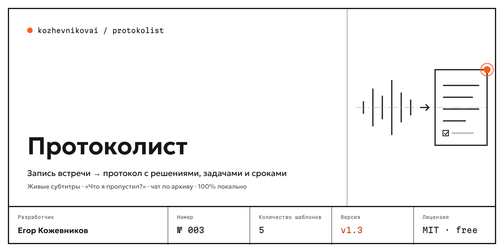
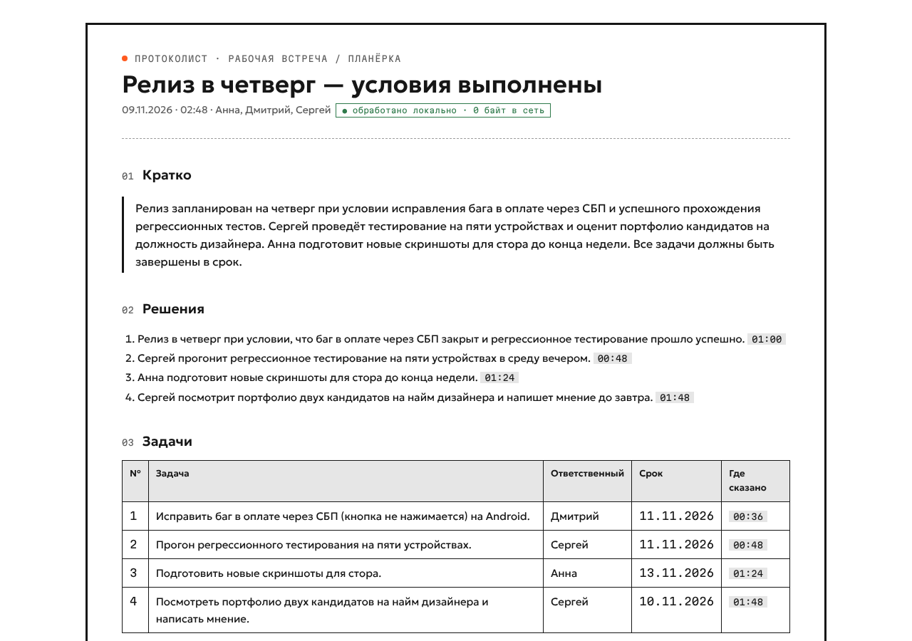

<a href="README.md">Русский</a> · <b>English</b>

# Protokolist — meeting recording → minutes, fully offline

Protokolist records Zoom, Yandex Telemost, Kontur.Talk, Teams or in-person meetings and produces minutes: decisions, action items with owners and due dates, open questions. **Everything runs on your computer — audio and text never leave it.** Built Russian-first; runs on an ordinary laptop without a GPU. Windows, macOS (beta), Claude Desktop extension and CLI.

## Highlights

- **Verifiable privacy.** A "Network: 0 bytes" counter in the window; strict offline mode is on by default. Data leaves the machine only when you press "→ Bitrix24" or enable a cloud model.
- **Every action item is backed by a quote and a timecode** — click to play the recording from that moment. Items the model couldn't ground in the transcript are flagged "verify" instead of being presented as fact.
- **"Me" is never confused**: microphone and meeting audio are recorded as separate tracks; other participants are separated by voice; speaker echo is filtered.
- **Spoken deadlines become dates** ("by Friday", "in two weeks") and go to calendar (.ics), Bitrix24 and YouGile.
- **Recording is always visible**: a tray icon and an always-on-top "Recording" indicator; start/stop from any app with Ctrl+Alt+R (⌘⌥R on Mac).
- **Official minutes per Russian standard GOST R 7.0.97-2016** in DOCX.
- **Russian ASR with GigaAM v3** (Sber, MIT): 3.7% WER and 98% speaker accuracy on the test recording, 8–9× faster than real time on a CPU.

Templates: team meeting, sales call, 1:1, job interview, GOST. Exports: HTML, DOCX, Markdown, JSON, TXT, SRT, ICS. Integrations: Bitrix24, YouGile, Telegram (PII masked before sending). Local search across all meetings.

## Install

- **App:** download the installer from the [latest release](https://github.com/kozhevnikovai/protokolist/releases/latest) (`.exe` for Windows, `.dmg` for macOS 14.2+). Builds are not code-signed yet: on Windows choose "More info → Run anyway"; on macOS use "System Settings → Privacy & Security → Open Anyway". Models (≈3–7 GB depending on the chosen model) download once on first launch.
- **Claude Desktop:** open the `.mcpb` from the release. Transcription runs locally, Claude writes the minutes, Protokolist verifies them against quotes.
- **CLI** (Node.js 20+): `npx protokolist models`, then `npx protokolist meeting.m4a`.

## Models

GigaAM v3 (MIT) via sherpa-onnx · Silero VAD (MIT) · CAM++ / 3D-Speaker (Apache-2.0) · a local LLM chosen by hardware — light Qwen3.5 4B / Gemma 4 E4B or strong GigaChat 3.1 Lightning / Qwen3.5 9B (Apache-2.0 / MIT) via node-llama-cpp and the shared [local-ai](https://github.com/kozhevnikovai/local-ai) engine.

## Author

Egor Kozhevnikov — [github.com/kozhevnikovai](https://github.com/kozhevnikovai). Product No. 003 of the kozhevnikovai line. MIT license.
