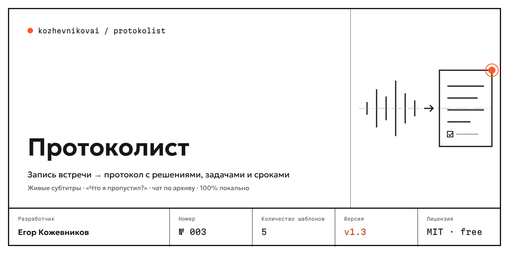
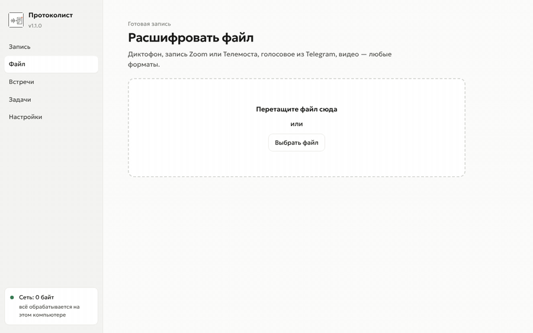
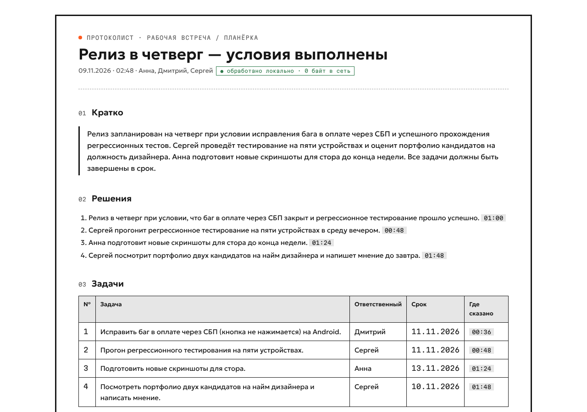
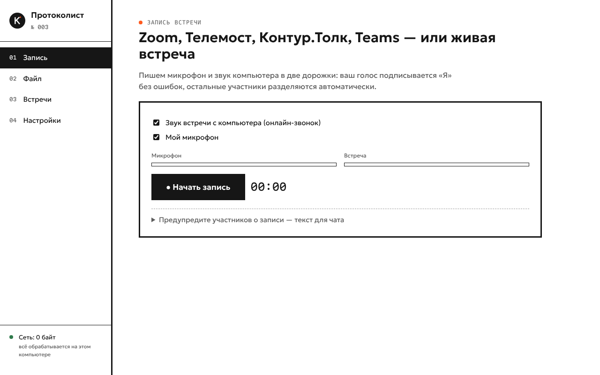
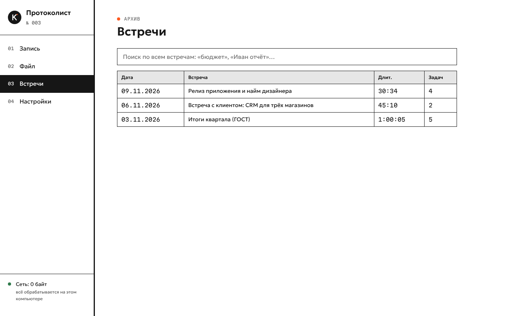

<p align="center"></p>

<p align="center">
<a href="https://github.com/kozhevnikovai/protokolist/actions/workflows/ci.yml"></a>
<a href="https://github.com/kozhevnikovai/protokolist/releases/latest"></a>


</p>

<p align="center"><b>Русский</b> · <a href="README.en.md">English</a></p>

# Протоколист — запись встречи → протокол

Записывает Zoom, Телемост, Контур.Толк, Teams или живую встречу и делает протокол: решения, задачи с ответственными и сроками, открытые вопросы. **Всё работает на вашем компьютере — запись и текст никуда не отправляются.** Русский язык в приоритете, обычный ноутбук без видеокарты подходит.

<p align="center"></p>

<p align="center"></p>

## Почему Протоколист

- **Приватность, которую можно проверить.** В углу окна — счётчик «Сеть: 0 байт». Распознавание и протокол делаются локальными моделями; данные уходят наружу, только если вы сами нажмёте «→ Битрикс24» или подключите облачную модель. Строгий офлайн-режим включён по умолчанию.
- **Каждая задача — с доказательством.** У решений и задач есть цитата и тайм-код: клик — и запись играет с этого места. Если модель не нашла подтверждения в стенограмме, пункт помечается «проверить», а не выдаётся за правду.
- **«Я» без ошибок.** Микрофон и звук встречи пишутся в две дорожки: ваш голос всегда подписан «Я», собеседники разделяются по голосам. Эхо из колонок отфильтровывается.
- **Сроки — датами.** «До пятницы», «через две недели», «к 15 ноября» превращаются в даты от дня встречи и попадают в календарь (.ics), Битрикс24 и YouGile.
- **Официальный протокол по ГОСТ Р 7.0.97-2016.** СЛУШАЛИ / ВЫСТУПИЛИ / РЕШИЛИ, поручения, подписи — в DOCX, готовом к печати.
- **Русский — лучше, чем у универсальных моделей.** Распознавание — GigaAM v3 (Сбер, MIT): на тестовой записи **3,7 % ошибок в словах** и **98 % точности спикеров** — на обычном процессоре, в 8–9 раз быстрее реального времени.

## Что умеет

| | |
|---|---|
| Запись | микрофон + звук компьютера; подсказка «Похоже, началась встреча в Zoom. Записать?» (Windows); текст-предупреждение участникам о записи; во время записи — значок в трее и индикатор «Идёт запись» поверх всех окон; старт и стоп из любого окна — Ctrl+Alt+R (⌘⌥R на Mac) |
| Файлы | любые аудио и видео: диктофон, запись Zoom/Телемоста, голосовые из Telegram, mp4 |
| Протокол | 5 шаблонов: планёрка, продажи (потребности, возражения, следующий шаг), один на один, собеседование, ГОСТ; сверка с повесткой — что не обсудили |
| Словарь компании | имена, продукты, термины — исправляет ошибки распознавания («битрикс двадцать четыре» → «Битрикс24») |
| Аналитика | кто сколько говорил, самый длинный монолог, перебивания, стоимость встречи в рублях |
| Форматы | HTML с плеером и поиском, DOCX (деловой и ГОСТ), Markdown, JSON, TXT, SRT, календарь .ics |
| Интеграции | задачи в **Битрикс24** и **YouGile** с ответственными и сроками, протокол в **Telegram**; телефоны, почта, ИНН маскируются перед отправкой |
| Архив | поиск по всем встречам: «что решили про бюджет?» — с тайм-кодами |
| Claude | расширение для Claude Desktop: запись расшифровывается локально, протокол составляет Claude, Протоколист проверяет его по цитатам |

<p align="center"> </p>

Пример результата: [протокол.html](docs/example/протокол.html) · [протокол.docx](docs/example/протокол.docx) · [протокол по ГОСТ](docs/example/протокол-гост.docx) · [протокол.md](docs/example/протокол.md)

## Установка

### 1. Приложение — для всех

Скачайте установщик на странице [последнего релиза](https://github.com/kozhevnikovai/protokolist/releases/latest):

- **Windows 10/11** — `Protokolist-…-win-x64.exe`. Установщик без платной подписи, поэтому Windows может показать «Система Windows защитила ваш компьютер»: нажмите «Подробнее» → «Выполнить в любом случае». Браузер может предупредить, что файл скачивают редко, — выберите «Сохранить».
  Не хотите устанавливать — скачайте портативную версию `Protokolist-…-win-x64.zip`, распакуйте и запустите `Protokolist.exe`.
- **macOS 14.2+ (бета)** — `Protokolist-…-mac-arm64.dmg` для M1 и новее, `…-mac-x64.dmg` для Intel. Приложение без подписи Apple: после первой попытки открыть зайдите в «Системные настройки → Конфиденциальность и безопасность» и нажмите «Всё равно открыть». Для записи звука встречи разрешите «Запись экрана и системного звука» (видео не пишется).

При первом запуске Протоколист скачает модели (≈ 3–7 ГБ в зависимости от выбранной модели, один раз). Дальше интернет не нужен.

### 2. Claude Desktop — протокол пишет Claude

Скачайте `protokolist-win-x64.mcpb` или `protokolist-mac-arm64.mcpb` из релиза и откройте двойным щелчком — Claude Desktop установит расширение. Затем попросите: «Сделай протокол встречи из файла C:\Записи\планёрка.m4a». Расшифровка идёт на компьютере, Claude получает только текст стенограммы.

### 3. Командная строка — для автоматизации

Нужен Node.js 20+.

```bash
npx protokolist models                 # скачать модели один раз
npx protokolist встреча.m4a            # протокол: HTML, DOCX, Markdown
npx protokolist продажи.mp3 -t sales -s 2 -n "s1=Марина"
npx protokolist совет.wav -t gost -a "Итоги квартала; График отпусков" -f docx
npx protokolist search бюджет          # поиск по всем встречам
```

Все команды: `npx protokolist --help`.

## Требования и скорость

| | Минимум | Комфортно |
|---|---|---|
| Процессор | 4 ядра (i5 8-го поколения, Ryzen 5) | 8+ ядер или Apple M1+ |
| Память | 8 ГБ (только стенограмма) / 16 ГБ (с протоколом) | 16 ГБ |
| Диск | 4 ГБ под модели | |
| Видеокарта | не нужна | любая с Vulkan (NVIDIA, AMD, Intel) или Apple Silicon — протокол в 5–10 раз быстрее |

Распознавание часовой встречи на 4-ядерном ноутбуке — около 7–10 минут (замер: в 8–9 раз быстрее реального времени). Протокол — ориентировочно ещё 5–15 минут без видеокарты и 1–2 минуты с ней; точные замеры на разных ноутбуках опубликуем по отзывам пользователей.

## Приватность и закон

- По умолчанию **ничего не уходит в сеть**: модели скачиваются один раз, дальше всё локально. Это видно по счётчику в окне и по отметке в каждом протоколе.
- Записывая встречу, предупредите участников — в окне записи есть готовый текст для чата. Пока идёт запись, поверх всех окон виден индикатор «Идёт запись», а в трее — красная точка: тайно записывать Протоколист не умеет.
- Настройка «Удалять запись после расшифровки» оставляет только текст.
- Облачную модель (OpenAI-совместимый API, например YandexGPT) можно подключить по желанию; она получает текст стенограммы. Для 152-ФЗ выбирайте провайдера с серверами в России.
- Ключи Битрикс24, YouGile, Telegram и облачной модели в приложении хранятся зашифрованными средствами Windows (DPAPI) или macOS (связка ключей). Для CLI и MCP их можно передать переменными окружения: `PROTOKOLIST_BITRIX24_WEBHOOK`, `PROTOKOLIST_YOUGILE_KEY`, `PROTOKOLIST_TELEGRAM_TOKEN`, `PROTOKOLIST_LLM_KEY`.
- Модели скачиваются с проверкой контрольных сумм SHA-256; MCP-сервер открывает только встречи из папки протоколов.

## Модели

| Задача | Модель | Лицензия |
|---|---|---|
| Распознавание речи | [GigaAM v3](https://github.com/salute-developers/GigaAM) (Сбер), ONNX через [sherpa-onnx](https://github.com/k2-fsa/sherpa-onnx) | MIT |
| Поиск речи | Silero VAD | MIT |
| Голоса спикеров | CAM++ ([3D-Speaker](https://github.com/modelscope/3D-Speaker)) | Apache-2.0 |
| Протокол | На выбор по компьютеру: лёгкая [Qwen3 4B Instruct](https://huggingface.co/Qwen/Qwen3-4B-Instruct-2507) или [Gemma 4 E4B](https://huggingface.co/google/gemma-4-E4B-it), мощная [GigaChat 3.1 Lightning](https://huggingface.co/ai-sage/GigaChat3.1-10B-A1.8B) или [Gemma 4 12B](https://huggingface.co/google/gemma-4-12b-it); GGUF через [node-llama-cpp](https://github.com/withcatai/node-llama-cpp) и общий движок [local-ai](https://github.com/kozhevnikovai/local-ai) | Apache-2.0 / MIT |

## Качество

- `npm test` — 71 модульный тест: сроки из речи, словарь, маскирование, цитаты, резюме без выдумок, кластеризация голосов, все форматы, интеграции, защита путей и ключей.
- `test/e2e.mjs` — сквозная проверка на реальной речи в CI на Windows, macOS и Linux: WER ≤ 8 %, ровно 3 спикера, точность спикеров ≥ 85 % (сейчас 3,7 % / 3 / 98 %).
- `npm run eval` — evals протокола на эталонных встречах (планёрка, продажи, хаотичная встреча, совещание по ГОСТ): полнота задач, ответственные, сроки, точность, подтверждение цитатами. Запускаются в GitHub Actions раз в неделю.

## Разработка

```bash
npm ci && npm run build && npm test
npx electron app/main.mjs                # приложение из исходников
npx electron-builder --win               # установщик (или --mac)
node scripts/build-mcpb.mjs              # расширение для Claude Desktop
```

Как помочь проекту — в [CONTRIBUTING.md](CONTRIBUTING.md). История версий — в [CHANGELOG.md](CHANGELOG.md).

## Планы

- **1.1** — профили голосов (участники узнаются сами от встречи к встрече), серии встреч со статусом задач с прошлой планёрки, Kaiten, Яндекс Трекер, Пачка, папка Obsidian, подсказка о начале встречи на macOS.
- **1.2** — живые субтитры и «Что я пропустил?», чат по архиву встреч.
- **2.0** — командная версия: один сервер в офисе на всю команду, общий архив, роли.

## Скоро

Всё, что есть сейчас, остаётся бесплатным и открытым (MIT). Платная версия — «Протоколист для команды» — в разработке, этих возможностей пока нет:

- **Общий архив команды** — протоколы всех сотрудников, поиск по всей компании, права доступа — *скоро*
- **Контроль поручений** — статусы задач, напоминания о сроках в Telegram, «что не сделано с прошлой планёрки» — *скоро*
- **Серии встреч** — планёрки и 1:1 в цепочке: что изменилось, какие вопросы тянутся — *скоро*
- **Знакомые голоса** — участники подписываются сами — *скоро*
- **Больше подключений** — amoCRM, Kaiten, Яндекс Трекер, календарь — *скоро*
- **Точнее и быстрее** — ускорение на видеокарте, усиленная модель, субтитры во время встречи — *скоро*

Нужно что-то из этого? [Оставьте заявку на ранний доступ](https://github.com/kozhevnikovai/protokolist/issues/new?template=early-access.yml) — заявки влияют на порядок разработки.

## Другие инструменты kozhevnikovai

- [Тендерный помощник](https://github.com/kozhevnikovai/tender-pomoshnik) — разбор госзакупок 44-ФЗ и 223-ФЗ с цитатами
- [site-audit-ru](https://github.com/kozhevnikovai/site-audit-ru) — аудит сайта и конкурентов, 152-ФЗ
- [ai-skills-ru-business](https://github.com/kozhevnikovai/ai-skills-ru-business) — 10 навыков для Claude: КП, отзывы, вакансии, регламенты

Об уязвимостях — приватно, см. [SECURITY.md](SECURITY.md).

## Автор

Егор Кожевников — [github.com/kozhevnikovai](https://github.com/kozhevnikovai). Продукт № 003 линейки kozhevnikovai. Лицензия MIT.
